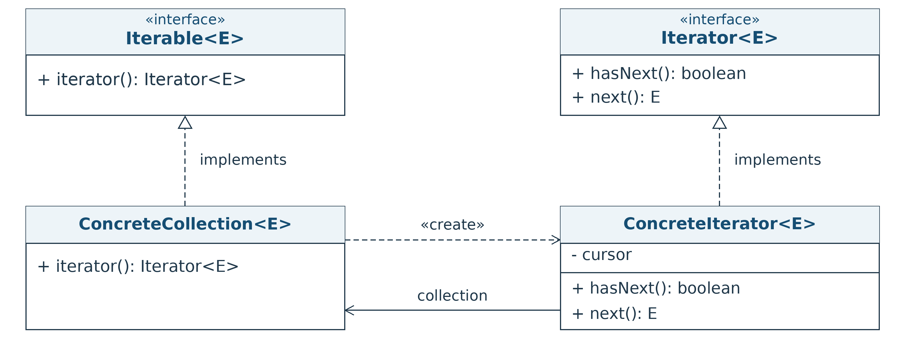

# A4.1 — Padrão Iterator

**Tópicos Avançados de Programação Orientada por Objetos · 2026/27**

Projeto Maven para estudar o padrão **Iterator**, retomando as pilhas e as árvores trabalhadas na UC. O exemplo da pilha em array está resolvido. As operações das estruturas também estão implementadas, para que a atividade se concentre nos iteradores.

## 1. Objetivos

- Distinguir `Iterable<E>` de `Iterator<E>`.
- Percorrer uma coleção sem expor a sua representação nem remover elementos.
- Implementar percursos independentes e respeitar o contrato do iterador Java.
- Relacionar a solução com abstração, encapsulamento e polimorfismo.



## 2. Preparação e execução

Requisitos: **JDK 17 ou superior** e **Maven 3.9 ou superior**. No IntelliJ IDEA, abrir a pasta que contém `pom.xml`, importar o projeto Maven e escolher um JDK compatível. Também pode usar a instalação Maven incluída no IDE.

Executar `pt.unips.estsetubal.tapoo.Main` no IDE.

O programa pode ser executado **antes de resolver os exercícios**. Mostra o exemplo de `StackArray` e assinala com `[PENDING]` os iteradores ainda por implementar. Depois de os completar, apresenta automaticamente os respetivos percursos.

Na primeira execução, o Maven necessita de acesso à Internet para obter as dependências.

## 3. Organização e ponto de partida

| Local | Conteúdo | Estado inicial |
| :--- | :--- | :--- |
| `src/main/java/pt/unips/estsetubal/tapoo/adt/Stack.java` | Contrato da pilha e métodos de iteração | Preparado |
| `StackArray.java`, no mesmo pacote | Pilha em array e iterador topo-base | Resolvido |
| `StackLinked.java`, no mesmo pacote | Pilha simplesmente ligada | Operações resolvidas; `iterator()` por implementar |
| `Tree.java` e `Position.java`, no mesmo pacote | Contrato da árvore baseado em posições | Preparado |
| `TreeLinked.java`, no mesmo pacote | Árvore genérica ordenada | Operações resolvidas; `iterator()` por implementar |
| `src/main/java/pt/unips/estsetubal/tapoo/Examples.java` | Construção de exemplos | Resolvido |
| `src/main/java/pt/unips/estsetubal/tapoo/Main.java` | Programa de demonstração | Executável |
| `src/test/java/pt/unips/estsetubal/tapoo/` | Testes JUnit 5 de base e dos exercícios | Ver secção 7 |

Mantém-se o pacote `pt.unips.estsetubal.tapoo.adt`, utilizado nos projetos anteriores. A classe `TreeLinked` corresponde à implementação ligada trabalhada como `TreeImpl` nas aulas A2, com o nome usado nos slides de Iterator. Preserva `Position`, validação de posições, ordem dos filhos e remoção limitada a folhas.

Os contratos `Stack<E>` e `Tree<E>` **já estendem `Iterable<E>`**. A atividade consiste em completar o comportamento de iteração. Não usar `java.util.Stack` em substituição da interface `Stack` da UC.

## 4. Atividades principais — cerca de 40 minutos

### 4.1. Rever o exemplo resolvido — 5 minutos

1. Executar o `Main` e analisar `StackArray.iterator()` e a classe interna `IteratorStack`.
2. Identificar onde se guarda o estado do percurso.
3. Explicar por que motivo `hasNext()` não altera a posição.
4. Confirmar que `next()` lança `NoSuchElementException` quando o percurso termina. A correção está incluída neste projeto.

Após `push(10)`, `push(20)` e `push(30)`:

| Operação | Resultado esperado |
| :--- | :--- |
| `for-each` ou iterador habitual | `30, 20, 10` |
| Estado final da pilha | `size() == 3` e `peek() == 30` |
| `first.next()`, `first.next()`, `second.next()` | `30, 20, 30`, com dois iteradores novos |

### 4.2. Exercício A: iterador da pilha ligada — 15 minutos

Completar `StackLinked.iterator()` e criar uma **classe interna privada** que implemente `java.util.Iterator<E>`.

Requisitos:

- Percorrer do **topo para a base**, com a mesma ordem do exemplo em array.
- Guardar uma referência ao nó atual **em cada iterador**.
- Preservar os elementos e as ligações da pilha.
- Devolver um iterador novo em cada chamada.
- Tratar a pilha vazia e o fim do percurso.

Usar `java.util.Iterator` e `java.util.NoSuchElementException`. A representação mantém-se a lista simplesmente ligada já fornecida.

Ativar os testes de `StackLinkedIteratorTest`, retirando a anotação `@Disabled` da classe, e executar `mvn test`.

### 4.3. Exercício B: iterador da árvore em pré-ordem — 15 minutos

Completar `TreeLinked.iterator()` para percorrer os **elementos** em pré-ordem, respeitando a ordem dos filhos.

A árvore de `Examples.createTree()` tem as seguintes relações:

| Nó | Filhos, pela ordem |
| :--- | :--- |
| A | B, C |
| B | D, E |
| C | F |
| D, E, F | Sem filhos |

| Percurso | Sequência |
| :--- | :--- |
| **Pré-ordem requerida para `iterator()`** | **A, B, D, E, C, F** |
| Largura de `elements()` neste projeto | A, B, C, D, E, F |

Pode escolher uma das abordagens:

- **Recursiva com lista auxiliar:** construir uma nova `java.util.ArrayList<E>` em pré-ordem e disponibilizar um iterador que rejeite `remove()`, por exemplo através de `java.util.Collections.unmodifiableList`. Considerar o custo de preparação e o espaço adicional, ambos O(n), além da pilha de chamadas.
- **Iterativa:** criar uma classe interna com uma `java.util.Stack<TreeNode>`. Inserir os filhos pela ordem inversa para que o primeiro filho seja o primeiro a sair. Usar `java.util.Iterator` e `java.util.NoSuchElementException`.

Em ambas as abordagens, cada chamada deve criar um percurso independente. Devolver diretamente `elements().iterator()` **não resolve o exercício**, porque essa sequência é em largura nesta implementação. O percurso deve visitar cada posição, mesmo quando existem elementos repetidos.

Não modificar as operações `positions()` e `elements()`, nem a representação da árvore. Ativar os testes de `TreeLinkedIteratorTest`, retirando a anotação `@Disabled`, e executar `mvn test`.

### 4.4. Validar e explicar — 5 minutos

- Executar novamente o `Main` e comparar as sequências com os resultados esperados.
- Confirmar a preservação das estruturas e a independência dos percursos.
- Preparar uma explicação breve das responsabilidades da coleção e do iterador.

## 5. Exercício adicional C: percurso da base para o topo

**Tempo indicativo: 20–30 minutos adicionais, ou trabalho autónomo.**

O contrato já disponibiliza o método:

```java
Iterator<E> iteratorInverse();
```

O corpo `default` em `Stack` é provisório e lança `UnsupportedOperationException`. Criar implementações próprias, com `@Override`, em **`StackArray` e `StackLinked`**, devolvendo um novo iterador da **base para o topo**.

```java
Iterator<Integer> iterator = stack.iteratorInverse();
while (iterator.hasNext()) {
    System.out.println(iterator.next());
}
```

Para a pilha de exemplo, o resultado é **10, 20, 30**. `iterator()` e o `for-each` devem continuar a produzir **30, 20, 10**.

No array, usar o índice do elemento atual. Na lista simplesmente ligada, planear uma forma de inverter o percurso sem modificar as ligações da pilha. Se precisar de uma estrutura auxiliar, usar **`java.util.Stack<Node>`** ou **`java.util.ArrayList<E>`**, identificando o custo de espaço e preparação.

Depois de concluir as duas implementações, ativar `InverseIteratorTest`, retirando `@Disabled`, e executar `mvn test`.

## 6. Contrato e cenários a validar

| Cenário | Resultado esperado |
| :--- | :--- |
| Estrutura vazia | `hasNext()` devolve `false`; `next()` lança `NoSuchElementException`. |
| Um elemento | O elemento é devolvido uma única vez. |
| Vários elementos | A sequência respeita a ordem definida. |
| Duas chamadas a `hasNext()` | O percurso não avança. |
| `next()` sem `hasNext()` prévio | Devolve o próximo elemento, ou lança a exceção se não existir. |
| `next()` depois de terminar | Lança `NoSuchElementException`. |
| Dois iteradores intercalados | Os estados dos percursos são independentes. |
| Elementos repetidos ou `null` | Todos são visitados. `null` não indica o fim. |
| `Iterator.remove()` | Lança `UnsupportedOperationException`. |
| Depois de percorrer | O conteúdo da estrutura mantém-se. |

**Hipótese da atividade:** não se altera a estrutura durante um percurso, mesmo que uma das soluções utilize uma lista auxiliar. Não é necessário implementar deteção de alterações, sincronização ou suporte para remoção através do iterador.

## 7. Testes fornecidos

| Classe de testes | Estado inicial | Momento de ativação |
| :--- | :--- | :--- |
| `BaseOperationsTest` | Ativa | Operações já resolvidas |
| `StackArrayIteratorTest` | Ativa | Exemplo já resolvido |
| `StackLinkedIteratorTest` | `@Disabled` | Exercício A |
| `TreeLinkedIteratorTest` | `@Disabled` | Exercício B |
| `InverseIteratorTest` | `@Disabled` | Exercício adicional C |

No projeto inicial, `mvn test` deve passar com os testes dos exercícios **assinalados como ignorados**. Isto valida o ponto de partida, mas não significa que os exercícios estão concluídos. Para validar cada implementação, retirar `@Disabled` da classe correspondente. Sem esta alteração, os seus testes continuam sem executar.


